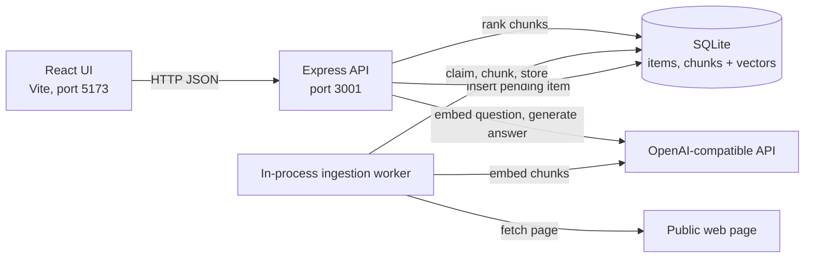

# AI Knowledge Inbox

A small full-stack app for saving notes and web pages, then asking questions about them. Answers come from a retrieval-augmented generation (RAG) pipeline and cite the exact saved passages they rely on. When the saved content does not support an answer, the app says so instead of guessing.

Built for the Turium AI full-stack assessment: single user, no authentication, runs locally.

## Features

- **Notes and URLs.** Save plain-text notes, or submit a public URL whose page is fetched and extracted on the server.
- **Asynchronous indexing.** Saving returns immediately. A background worker chunks and embeds the content, and each item shows its state: Queued, Processing, Ready or Failed. Failed items show the reason and can be retried.
- **Semantic retrieval.** Questions are embedded and matched against saved chunks by cosine similarity, with a relevance threshold and a context budget.
- **Cited answers.** The language model answers only from the retrieved passages. Every citation is checked against the passages actually sent, and the UI links each one to its source snippet.
- **Insufficient-evidence handling.** If nothing relevant is saved, or the model reports that the passages do not answer the question, the app returns an explicit "not enough evidence" result with no citations.
- **Safe URL fetching.** Only public `http`/`https` destinations are allowed. Private, loopback and link-local addresses are blocked, including after DNS resolution and redirects, and the fetch has a time limit and a size limit.

## Architecture



- **Frontend (`web/`).** React with two hooks that own server state. `useItems` polls only while items are being processed. `useAsk` cancels any in-flight question so a slow answer cannot overwrite a newer one. Components are presentational.
- **Backend (`server/`).** Express routes validate input with Zod and delegate to services. Services hold the logic, repositories hold the SQL, and the AI provider sits behind an interface so tests can substitute a fake.
- **Database.** SQLite through Node's built-in `node:sqlite`. Items and their chunks, including embedding vectors, live in one file. Schema migrations run automatically at startup.
- **Ingestion worker.** `POST /ingest` stores the item as `pending` and returns `202`. The worker claims one item at a time, fetches and extracts URLs, chunks the text, embeds the chunks, and stores the chunks and the `indexed` status in a single transaction. Retryable failures are retried with backoff up to a limit. Items left `processing` by a crash are recovered at the next start.
- **Retrieval and answers.** `POST /query` embeds the question with the same embedding model, scores every chunk of every indexed item, keeps those above the threshold within the top-K and a character budget, and sends them to the chat model as numbered passages. The JSON reply is validated before anything is returned.

## Tech stack

| Area | Technologies |
| --- | --- |
| Backend | Node.js ≥ 22.13, TypeScript, Express 5, Zod, Pino and `pino-http`, Cheerio, official `openai` SDK |
| Database | SQLite via built-in `node:sqlite` |
| Frontend | React 19, Vite, plain CSS |
| Testing | Vitest, Supertest, Testing Library, jsdom |
| Tooling | npm workspaces (`server`, `web`), `tsx`, `concurrently` |

## Setup

**Prerequisites:** Node.js 22.13 or newer, which includes npm. It was developed and tested on Node 26. You also need an API key for OpenAI, or a local Ollama install as an alternative.

```bash
git clone <repository-url>
cd <repository-folder>
npm install                              # installs both workspaces

cp server/.env.example server/.env       # then set AI_API_KEY in server/.env
npm run dev                              # API on :3001, UI on :5173
```

Open **http://localhost:5173**. Use `localhost` rather than `127.0.0.1`, because the Vite dev server may listen only on the IPv6 loopback.

- **Database.** It is created and migrated automatically at `server/data/inbox.db` on first start. `npm run db:migrate` does the same thing explicitly.
- **Single process.** `npm run build && npm start` serves the built UI and the API together on **http://localhost:3001**.

### Environment variables

The server reads **`server/.env`**. Variables already set in your shell take precedence over the file. `server/.env` and the database are git-ignored and must stay local. Only `server/.env.example` is committed, and it contains no secrets.

| Variable | Required | Default | Purpose |
| --- | --- | --- | --- |
| `AI_API_KEY` | **yes** | none | API key for the provider. The server refuses to start without it, and it is never logged |
| `AI_BASE_URL` | no | `https://api.openai.com/v1` | Any OpenAI-compatible endpoint |
| `EMBEDDING_MODEL` | no | `text-embedding-3-small` | Stored with every chunk, so vectors from different models are never mixed |
| `CHAT_MODEL` | no | `gpt-4o-mini` | Model that writes answers |
| `EMBEDDING_DIMENSIONS` | no | unset | If set, vectors of any other length are rejected |
| `DATABASE_PATH` | no | `./data/inbox.db` | SQLite file, relative to `server/` |
| `PORT` | no | `3001` | API port |
| `RETRIEVAL_MIN_SCORE` | no | `0.30` | Cosine-similarity threshold, see [Relevance threshold](#relevance-threshold) |
| `RETRIEVAL_TOP_K` / `RETRIEVAL_CONTEXT_BUDGET_CHARS` | no | `6` / `12000` | Maximum passages and characters sent to the model |
| `CHUNK_SIZE_CHARS` / `CHUNK_OVERLAP_CHARS` | no | `2800` / `400` | Chunk window and overlap |
| `AI_TIMEOUT_MS` / `AI_MAX_RETRIES` | no | `30000` / `2` | Provider timeout and bounded retries |
| `INGEST_MAX_ATTEMPTS` / `INGEST_POLL_INTERVAL_MS` | no | `3` / `1000` | Worker attempt limit and poll interval |
| `NOTE_MAX_CHARS` | no | `50000` | Maximum note length |
| `URL_FETCH_TIMEOUT_MS` / `URL_MAX_BYTES` / `URL_MAX_REDIRECTS` | no | `10000` / `2000000` / `3` | URL fetch limits |
| `LOG_LEVEL` | no | `info` | Pino log level |
| `VITE_API_TARGET` | no | `http://localhost:3001` | Dev only: where the Vite proxy sends API calls. Read from the shell, not from `server/.env` |

Example `server/.env` for OpenAI:

```bash
AI_API_KEY=your-openai-api-key
```

Example `server/.env` for a local Ollama setup, matching the checks recorded in `docs/VERIFICATION.md`:

```bash
AI_BASE_URL=http://127.0.0.1:11434/v1
AI_API_KEY=ollama
EMBEDDING_MODEL=nomic-embed-text
CHAT_MODEL=qwen2.5:1.5b
RETRIEVAL_MIN_SCORE=0.5
# then: ollama pull nomic-embed-text && ollama pull qwen2.5:1.5b
```

## Usage

1. **Save a note.** On the **Add note** tab, type or paste text and click **Save note**.
2. **Save a URL.** On the **Add URL** tab, enter a public page such as a Wikipedia article and click **Save URL**. A literal private or local address is rejected immediately. A hostname that resolves to one fails during indexing, with the reason shown on the item.
3. **Wait for indexing.** The item moves from Queued to Processing to Ready. A failed item shows the reason and a **Retry** button. Click an item's title to see the exact content that was indexed.
4. **Ask a question.** Type it in the **Ask** panel. The answer shows `[n]` markers linked to numbered sources, and each source shows its title, a snippet and a similarity score.
5. **Unsupported questions.** A question your saved content cannot answer returns "Not enough evidence in your saved knowledge", together with the retrieval statistics.

## API

All bodies are JSON. Every response carries an `x-request-id` header. Errors share one shape:

```json
{ "error": { "code": "validation_error", "message": "Invalid ingest request: content: content is required", "requestId": "…" } }
```

| Code | HTTP status | When |
| --- | --- | --- |
| `validation_error` | 400, or 413 for an oversized body | Malformed input, bad JSON, unsupported URL scheme, credentials in a URL |
| `not_found` | 404 | Unknown item or route |
| `conflict` | 409 | Retry requested for an item that is not `failed` |
| `url_blocked` / `url_unsupported_content` / `extraction_failed` | 422 | Disallowed destination, a content type other than HTML or plain text, or no readable text |
| `url_fetch_failed` / `provider_error` | 502 | Network or fetch failure, or an AI provider failure, including an answer cut off at the token limit |
| `provider_rate_limited` | 503 | Provider rate limit after bounded retries |
| `internal_error` | 500 | Unexpected error; details are logged, not returned |

### `POST /ingest` → `202 Accepted`

```json
{ "type": "note", "content": "Our office plant is named Gerald.", "title": "Office" }
{ "type": "url", "url": "https://en.wikipedia.org/wiki/Retrieval-augmented_generation" }
```

`title` is optional. The response is `{ "item": ItemSummary }` with `status: "pending"`, and indexing continues in the background.

### `GET /items?limit=50&offset=0` → `200`

```json
{
  "items": [{
    "id": "uuid", "sourceType": "url", "title": "…", "url": "…",
    "contentPreview": "first ~200 characters…", "contentChars": 16446, "chunkCount": 8,
    "status": "indexed", "attempts": 1, "error": null,
    "createdAt": "…", "updatedAt": "…", "startedAt": "…", "completedAt": "…"
  }],
  "total": 1, "limit": 50, "offset": 0
}
```

Items are listed newest first. `limit` ranges from 1 to 100. `status` is `pending`, `processing`, `indexed` or `failed`, and a failed item carries `error: { code, message }`. Embeddings and full content are never included in the list.

Related endpoints:
- `GET /items/:id` returns `{ item }` with the full `content`.
- `POST /items/:id/retry` requeues a `failed` item and returns `202`, or returns `409` for any other status.

### `POST /query` → `200`

```json
{ "question": "What is the office plant called?", "topK": 6, "minScore": 0.3 }
```

`topK` (1 to 20) and `minScore` (-1 to 1) are optional overrides.

```json
{
  "answer": "The office plant is named Gerald [1].",
  "sufficientEvidence": true,
  "insufficientReason": null,
  "citations": [{
    "passage": 1, "chunkId": "<itemId>:0", "itemId": "…", "chunkIndex": 0,
    "title": "Office", "sourceType": "note", "url": null,
    "snippet": "Our office plant is named Gerald.", "score": 0.72
  }],
  "retrieval": { "candidates": 9, "aboveThreshold": 2, "selected": 2, "topK": 6, "minScore": 0.3, "topScore": 0.72 }
}
```

`[n]` in `answer` refers to `citations[].passage`. When evidence is insufficient the status is still `200`, with `sufficientEvidence: false`, an empty `citations` array, a fixed explanatory `answer`, and one of these values for `insufficientReason`:

| `insufficientReason` | Meaning |
| --- | --- |
| `no_indexed_content` | Nothing is indexed yet. No provider call is made |
| `no_relevant_chunks` | Nothing scored above the threshold. No chat call is made |
| `model_reported_insufficient` | The model said the passages do not answer the question. Its own wording is not returned |
| `unverifiable_answer` | The reply was malformed, or claimed an answer without a valid citation |

### `GET /health` → `200`

```json
{ "status": "ok", "uptimeSeconds": 12, "items": { "pending": 0, "processing": 0, "indexed": 2, "failed": 0 },
  "models": { "embedding": "text-embedding-3-small", "chat": "gpt-4o-mini" },
  "worker": { "state": "ok", "consecutiveFailures": 0, "lastFailureAt": null, "currentItemId": null } }
```

`status` becomes `degraded` while the worker loop is failing, for example while the database is unavailable. This endpoint never calls the AI provider.

## Testing

```bash
npm test             # server and web test suites
npm run typecheck    # strict TypeScript for both packages
npm run build        # compiles the server and builds the web bundle
```

- **Automated tests use no real AI provider.** There are 249 server tests and 15 web tests. The server suite uses a deterministic fake provider, in-memory SQLite, and local HTTP fixture servers for URL fetching. That covers SSRF blocking, redirects, timeouts, size limits, worker retries and recovery, and answer and citation validation. The provider adapter is tested against the real `openai` SDK with a stubbed `fetch`. The web tests cover the add, list, retry and ask flows.
- **Live check against local Ollama.** `scripts/live-verify.mjs` starts its own server on a temporary database and runs the full flow: a note, two factual questions with citations, an unrelated question, blocked and failing URLs, a public URL, and a restart. With `nomic-embed-text` and `qwen2.5:1.5b`, it passed 15 of 15 checks.
- **Manual check against the real OpenAI API.** Using the defaults (`text-embedding-3-small`, `gpt-4o-mini`), the author saved a note and a Wikipedia article through the UI. The author then got cited answers to questions about both, and an insufficient-evidence result for an unrelated question. The local database confirms both items were indexed with 1,536-dimension `text-embedding-3-small` vectors. Relevance scores from these runs were not recorded, and `live-verify.mjs` has not been run against OpenAI.

Details and evidence are in [`docs/VERIFICATION.md`](docs/VERIFICATION.md).

## Design decisions and tradeoffs

### Chunking

The chunker uses a character-based sliding window of about 2,800 characters, roughly 700 tokens, with a 400-character overlap. It packs whole paragraphs, splits long paragraphs at sentence boundaries, and hard-splits only a single oversized sentence. The overlap means a fact that straddles a boundary is still retrievable from at least one chunk.

About 700 tokens keeps a definition together with its context while still fitting six passages into a roughly 3,000-token evidence budget. Smaller chunks sharpen short factual lookups but fragment explanations. Larger chunks dilute the embedding and make citations vague. Counting characters keeps chunking deterministic across providers, at the cost of only approximating token counts.

### Storage and vector search

Everything lives in one SQLite file. Vectors are stored as Float32 blobs next to their chunk text, and search is a linear cosine scan in application code. For a single user's inbox of a few thousand chunks, the scan is fast compared with the AI calls, it stays transactional with the rest of the data, and it needs no extra service. The embedding model and vector dimension are stored per chunk, so switching models never mixes incompatible vectors. A vector index or a dedicated vector database is the change to make once the corpus grows large.

### Relevance threshold

Cosine ranges differ by embedding model:
- **Ollama.** With `nomic-embed-text`, recorded relevant scores were 0.72 to 0.76 and an unrelated question scored 0.39, so the Ollama setup uses 0.5.
- **OpenAI.** With the `0.30` default and `text-embedding-3-small`, the manual OpenAI runs answered the relevant questions and declined the unrelated one, but the scores were not recorded. Treat it as a starting point and tune it from the `retrieval.topScore` value each query returns.

### Evidence validation

The model must reply in JSON with `answer`, `sufficient` and `citations`:
- **Answers.** One counts as answered only when `sufficient` is exactly `true` and at least one cited passage number matches a passage that was actually sent. Citation numbers that were not sent are dropped.
- **Malformed or truncated replies.** These are never shown. Neither is the model's wording when it reports insufficient evidence, because that text is by definition unsupported.
- **Untrusted content.** Fetched page text is sent only as quoted passages, with an instruction to ignore any instructions inside them. The model has no tools.

### Asynchronous ingestion

Fetching and embedding take seconds and can fail, so the API acknowledges with `202` and the worker does the work. That gives persisted status, bounded retries with backoff, and recovery after a crash. Writes that record an outcome apply only while the item is still `processing`, so a late result cannot overwrite a finished item.

### What would change at scale

- **Search.** Replace the linear scan with an approximate nearest-neighbour index, for example pgvector or `sqlite-vec`.
- **Database.** Move to Postgres to remove SQLite's single-writer limit.
- **Jobs.** Move from the in-process worker to a durable job queue with leases.
- **Ingestion quality.** Add a proper content extractor and PDF support.
- **Context budget.** Count tokens accurately instead of estimating from characters.
- **Retrieval quality.** Build an evaluation set to tune the threshold, and add a reranker.
- **Multiple users.** Add per-user data isolation and authentication.

## Known limitations

- **One process per database file.** The worker assumes it is the only one using the database. This is documented, not enforced. A second server process on the same file could reprocess a running job and repeat its provider calls. Stored state stays consistent, but the duplicated work and cost are not prevented.
- **Basic HTML extraction.** It is heuristic. JavaScript-rendered pages and PDFs are not supported and fail with a clear error.
- **Ambiguous citation markers.** A bracketed number inside the valid passage range, such as `[2]` used in prose, is treated as a citation.
- **No editing or deletion.** Items cannot be edited or deleted from the UI.
- **Single user.** There is no authentication or rate limiting.
- **Untested provider errors.** Real OpenAI error responses such as rate limits and invalid keys are mapped in code but have not been exercised live.

## Further documentation

- [`docs/WALKTHROUGH.md`](docs/WALKTHROUGH.md): a ten-minute guided tour of the design.
- [`docs/TRACEABILITY.md`](docs/TRACEABILITY.md): each assessment requirement mapped to its code and tests.
- [`docs/VERIFICATION.md`](docs/VERIFICATION.md): what was verified, how, and what was not.
